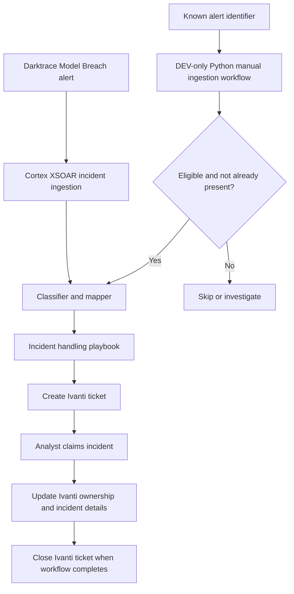

# Cortex XSOAR — Darktrace Incident Automation & Ivanti ITSM Integration

> **Portfolio case study | Security Orchestration, Automation & Response (SOAR)**  
> **Focus:** SOC automation, API integrations, Python, incident lifecycle management  
> **Platforms:** Cortex XSOAR, Darktrace, Ivanti ITSM  
> **Timeline:** 2026  
> **Project status:** Main integration tested and deployed to production; supplementary manual ingestion automation tested in development.

## Overview

I contributed to an enterprise SOC automation initiative that connects Darktrace Model Breach alerts with Cortex XSOAR and Ivanti ITSM. The goal was to streamline incident handling from detection through analyst assignment and ticket closure, while reducing repetitive manual ticketing steps.

Alongside the main workflow, I built and iteratively troubleshot a **Python-based manual ingestion automation** for selected Darktrace alerts that were retrievable on demand but not consistently picked up by automated incident fetching.

**Confidentiality:** This is a generalized account of work performed in a professional environment. It intentionally omits real incidents, internal infrastructure details, credentials, production code, proprietary configurations, and organizational data.

## Problem statement

The SOC needed a consistent way to:
- Turn eligible Darktrace detections into actionable XSOAR incidents.
- Open, update, and close corresponding Ivanti tickets.
- Let the responding analyst claim ownership of a case.
- Preserve alert details and descriptions in downstream ITSM tickets.
- Investigate alerts missing from automatic ingestion without blindly creating duplicates.

## Architecture

*The diagram is conceptual. It is not a production configuration export. The manual ingestion path was developed separately in DEV and is not represented as deployed to production.*

## My contributions

### 1. Darktrace-to-Ivanti playbook customization
- Configured and validated Cortex XSOAR incident classifiers and field mappers.
- Customized the Darktrace incident layout and adapted the model-breach handling workflow.
- Integrated ticket creation, updates, assignment handling, and closure with Ivanti.
- Debugged required ticket data, including record identifiers, cause codes, priorities, and descriptions.
- Used playbook execution results and incident testing to verify behavior in DEV before production rollout.

### 2. Analyst claim workflow
- Customized incident handling around the XSOAR `AssignToMeButton`.
- Used analyst claim as an explicit part of the workflow so ownership could reflect the person handling the alert.
- Validated the transition from incident claim to downstream ticket handling.

### 3. Automatic ingestion troubleshooting
I investigated a gap between eligible alerts visible in Darktrace and incidents automatically fetched into XSOAR. Troubleshooting included:
- Comparing alerts in the source platform with XSOAR incidents.
- Checking priority values, timestamps, and fetch behavior.
- Testing retrieval of individual alerts by identifier.
- Resetting and comparing fetch behavior in DEV and PROD.

**Finding:** Individual alert retrieval could work even when automatic ingestion was inconsistent. The cause of all missing automatic fetches was not conclusively established in this project phase.

### 4. Python manual ingestion automation
I developed a complementary automation to retrieve selected Darktrace Model Breach alerts by identifier, inspect their data, evaluate an eligibility threshold, and search for existing incidents before controlled creation.

Implementation and tests included:
- A PBID/alert-identifier input.
- API-based retrieval through the available Darktrace integration.
- Priority filtering and alert-context processing.
- Duplicate-search diagnostics to reduce accidental repeat ingestion.
- Controlled DEV incident creation and downstream playbook execution.
- Fixing the propagation of alert descriptions into the Ivanti ticket workflow.

**Important distinction:** A successful controlled test is not the same as fully validated duplicate prevention across all edge cases or production deployment. Broader duplicate testing and automatic-fetch root cause analysis were follow-up items.

## Challenges and resolution

| Challenge | Approach |
| --- | --- |
| Missing required Ivanti fields | Reviewed task outputs and corrected mappings for required ticket values |
| Analyst assignment behavior | Customized claim action and workflow sequencing |
| Ticket description missing | Traced the alert context through incident fields and downstream ticket tasks; corrected mapping |
| Darktrace alerts absent from automatic fetch | Compared source alerts, manual retrieval, and DEV/PROD fetch behavior |
| Risk of duplicate incidents | Added duplicate lookup diagnostics and constrained manual creation tests |

## Validation

Confirmed during project testing:
- The main Darktrace-to-Ivanti workflow could create, update, assign, and close tickets.
- The updated playbook handled analyst claims.
- Ticket description context was successfully passed after mapping corrections.
- The main integration advanced from DEV into production.
- A controlled DEV manual ingestion test created an incident that executed the downstream workflow.

**Not claimed:** Quantified analyst time savings, completed organization-wide duplicate-prevention validation, or production deployment of the manual ingestion script.

## Skills demonstrated

**SOAR engineering:** Cortex XSOAR playbooks, incident classifiers/mappers, task sequencing, incident lifecycle design, DEV/PROD testing.  
**Development:** Python, JSON/data mapping, integration debugging, input validation, duplicate-search logic.  
**SOC operations:** Alert triage, incident investigation, analyst ownership, ticketing workflows, detection-platform integration.

## Future enhancements

- Expand duplicate detection tests to cover repeated runs and different incident states.
- Continue investigating automatic Darktrace fetch gaps.
- Improve error handling and operational diagnostics.
- Document separately developed Varonis and Cortex XDR integration initiatives as they mature.

## Portfolio note

This case study describes responsibilities and technical work without disclosing any employer-owned source code or sensitive information. Any future demonstration code or screenshots should be independently created, sanitized, and approved for public distribution.

---
**Author:** Daeja Banner  
**Specialties:** SOC Operations · Security Automation · Incident Response · SOAR Engineering
