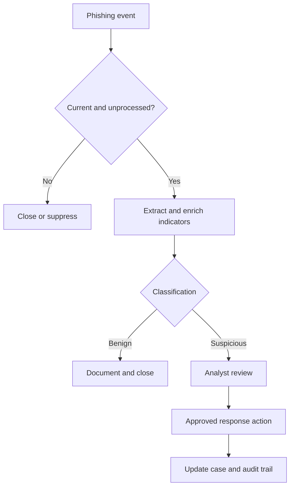

# Cortex XSOAR Phishing Automation Recovery

> **Sanitized portfolio case study:** Employer names, personnel, internal identifiers, infrastructure details, exact alert volumes, credentials, and proprietary workflow names have been generalized or omitted.

## Project Summary

| Area | Details |
|---|---|
| Platform | Palo Alto Networks Cortex XSOAR (formerly Demisto) |
| Use case | Automated phishing triage and response |
| Project type | SOAR troubleshooting and workflow optimization |
| Status | Completed and validated |
| Role | SOC analyst responsible for investigation, playbook troubleshooting, remediation coordination, testing, and documentation |

I restored reliability to a production phishing-response playbook that was ingesting stale alerts and experiencing failures in downstream enrichment and email-response actions. I traced the problems across playbook logic, API authentication, permissions, and dependent integrations; coordinated the required access changes; updated the workflow; and performed end-to-end validation.

## The Problem

A legacy phishing automation had accumulated technical debt and was no longer behaving as intended:

- Alert-selection logic could retrieve previously unseen phishing records regardless of age, introducing months-old events into the active queue.
- A failed API dependency interrupted URL and domain categorization.
- Authentication and permission issues prevented an email search-and-delete action from completing.
- Stale and failed tasks increased analyst review effort and reduced confidence in the workflow.

## Objectives

- Restrict processing to relevant, current phishing events.
- Restore indicator enrichment and approved email-response actions.
- Preserve human review for ambiguous or high-impact decisions.
- Validate the complete workflow before returning it to routine use.
- Document the remediation for approval and future support.

## Solution

### 1. Isolated the failure domains

I reviewed incident timestamps, task results, conditional branches, error messages, and integration health. This separated the stale-alert logic defect from independent API and authentication failures.

### 2. Corrected event-selection behavior

I adjusted the workflow logic so it focused on relevant current events rather than treating any previously unseen historical record as actionable.

### 3. Restored enrichment

I traced the failed URL/domain categorization task to an invalid API token associated with a changed external dependency. Once restored, enrichment results could again support malicious-versus-benign branching.

### 4. Repaired the response integration

I troubleshot the search-and-delete sub-playbook, revalidated integration credentials, and coordinated the required API permission changes with the appropriate platform owner and vendor support.

### 5. Validated and documented the remediation

I ran controlled tests through the applicable branches, confirmed context passed correctly between tasks, verified the response action, and documented the changes for operational review.

## Conceptual Workflow

This diagram represents the generalized decision flow, not the employer's production architecture or proprietary playbook.

## Tools and Integrations

- **Cortex XSOAR:** Orchestration, conditional logic, case context, and execution
- **Enterprise email API:** Message retrieval and approved remediation actions
- **Reputation service:** URL and domain enrichment
- **IT service-management platform:** Case tracking and operational handoff
- **Identity platform:** Application authentication and permission management

## Security Considerations

- Applied least-privilege thinking to mailbox permissions and response actions.
- Kept secrets in managed credential storage rather than playbook logic or documentation.
- Preserved analyst review for uncertain cases and potentially destructive actions.
- Added scope controls to avoid stale or duplicate processing.
- Retained task results, case notes, and approvals for auditability.
- Used controlled test cases before returning the workflow to routine operation.
- Excluded real usernames, domains, tenant data, IP addresses, ticket numbers, queries, and screenshots from this repository.

## Outcome

- Stopped the known stale-alert behavior.
- Restored URL/domain categorization.
- Restored the approved email-remediation path.
- Completed successful end-to-end verification after the changes.
- Returned the workflow to stable operation and reduced avoidable manual review caused by stale cases and failed tasks.

### Measurement Boundary

The project records support a state-based result: before remediation, stale alerts and failed integrations repeatedly disrupted the workflow; after remediation, the playbook completed end to end during validation and resumed stable processing without the known stale-alert behavior. Exact operational volumes and internal performance data are intentionally omitted.

## Skills Demonstrated

- SOAR playbook troubleshooting and modification
- Conditional workflow design
- API authentication and permission analysis
- Integration dependency troubleshooting
- Secure credential handling
- Incident-response automation
- Cross-functional and vendor coordination
- Change documentation and validation
- Human-in-the-loop security controls

## Interview Summary

**Situation:** A production phishing playbook was pulling months-old alerts, while enrichment and email-response actions were failing.

**Task:** Restore the automation safely and ensure it processed relevant cases without creating additional business risk.

**Action:** I separated playbook-logic defects from integration failures, corrected event selection, traced a failed enrichment step to an invalid API token, revalidated the email integration, coordinated permission changes, and tested the workflow through its decision branches.

**Result:** The stale-alert behavior stopped, enrichment and email remediation were restored, and the playbook completed end-to-end validation before returning to stable operation.

## Confidentiality

This repository documents my troubleshooting and automation-engineering approach without exposing employer-sensitive information. It contains no production exports, screenshots, credentials, exact queries, internal topology, or confidential operational data.
